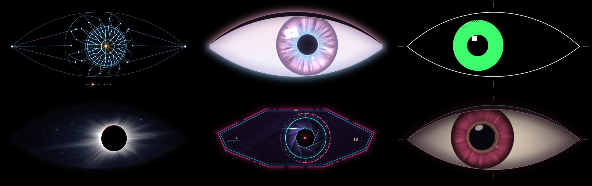

# Vesper Eye

Глаз на рабочем столе для **Dux Shell** (бывший DankMaterialShell, DMS) под Hyprland. Следит за указателем, моргает, дремлет и засыпает, смотрит в сторону уведомлений — и ничего не тратит, когда его не видно.

Версия 1.0 — новый движок и сменные образы. Работает в Dux Shell 2.1 и в DMS 1.6.



## Образы

| Образ | Что это |
|---|---|
| **Перламутр** | Пастель: белый, розовый, голубой. Опаловая радужка с переливом. Есть тёмный и светлый варианты |
| **Сигнал** | Чёрный, белый, серый и одна ярко-зелёная радужка. Плоская графика. Есть тёмный и светлый варианты |
| **Затмение** | Полное солнечное затмение: чёрный диск и корона; при взгляде в сторону выглядывает серп |
| **Связи** | Объёмный шар из узлов и связей: поворачивается за указателем, показывает рабочие столы, сеть и VPN |
| **Неон-нуар** | Киберпанк: диафрагма-имплант, маджента и циан |
| **Веспер** | Прежний готический вид: гранат, кость, латунь |

Все образы можно посмотреть вживую в браузере: откройте `design/board/index.html`.

## Установка

Нужны Hyprland, Quickshell с Qt 6 и оболочка Dux Shell 2.1 или DMS 1.6. Python больше не требуется.

1. Скопируйте репозиторий в каталог плагинов оболочки под именем `vesperEye`:
   - Dux Shell 2.x: `~/.config/dms/plugins/vesperEye`
   - DMS 1.6: `~/.config/DankMaterialShell/plugins/vesperEye`
2. Перезапустите оболочку (`dms restart`): новые QML-файлы она подхватывает только при запуске.
3. В настройках оболочки добавьте виджет рабочего стола **Vesper Eye**. Размер и положение меняются редактором виджетов оболочки.

Обновление с версии 0.1: замените содержимое каталога плагина и перезапустите оболочку. Настройки экземпляра сохраняются.

## Настройки

- **Образ** и **вариант** (тёмный, светлый или по теме оболочки). По умолчанию образ берётся из профиля оформления: если в файле темы оболочки есть поле `"vesperEye": { "skin": "signal", "variant": "dark" }`, глаз меняется вместе с темой.
- **Характер:** спокойный, живой (редкие осмотры и микродвижения) или неподвижный.
- **Цвета из темы оболочки:** акценты образа берутся из текущей темы.
- Слежение за указателем, взгляд на уведомления, реакция на музыку, экономичный режим, предел кадров.

## Как он бережёт батарею

- Закрыт окнами, полноэкранное окно, блокировка экрана — глаз не опрашивает указатель и не рисует ни одного кадра.
- Человек не трогает компьютер три секунды — опрос указателя останавливается; остаётся редкое моргание.
- Указатель движется — кадр рисуется, только когда картинка заметно меняется, и не чаще заданного предела (по умолчанию 60 в секунду).
- Позиция указателя берётся у Hyprland прямо из оболочки, без отдельного процесса.
- На OLED рисунок раз в три минуты смещается на пару пикселей, а во сне тускнеет.

## Поведение

- Удержание левой кнопки на глазу закрывает веки, двойной щелчок вызывает удивление.
- Через 10 секунд без движения — дремота, ещё через минуту — сон. Любой ввод будит.
- Уведомление — взгляд в его сторону (текст не читается). Смена рабочего стола — взгляд вслед.
- На батарее ниже 15% веко тяжелеет.
- Нет камеры, микрофона, перехвата клавиатуры и сетевых запросов.

## Разработка

```sh
python3 tools/build.py                 # шейдеры для Qt (нужен qsb из qt6-shadertools), данные образов, доска
QT_QPA_PLATFORM=offscreen qmltestrunner -input tests/tst_core.qml
tools/shot.sh out.png 950 450 'solo=pearl&gx=0.4&lt=0.1&bg=000000'   # кадр доски без экрана (chromium, Pillow)
python3 tools/package.py               # архив для установки в .dist/
```

Один исходник шейдера (`shaders/src/<образ>.glsl`) собирается и для плагина, и для браузерной доски. Как добавить свой образ: [docs/SKINS.md](docs/SKINS.md). Устройство движка: [docs/ARCHITECTURE.md](docs/ARCHITECTURE.md).

`legacy/v0.1/` — прежняя версия 0.1.1 целиком, `legacy/noctalia/` — исходный глаз для Noctalia. Это архив, плагин от них не зависит.

MIT; исходные уведомления сохранены в `LICENSE` и `legacy/noctalia/LICENSE`.
